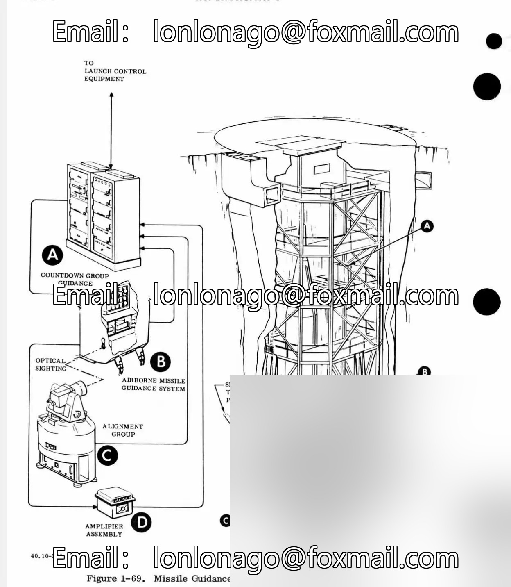
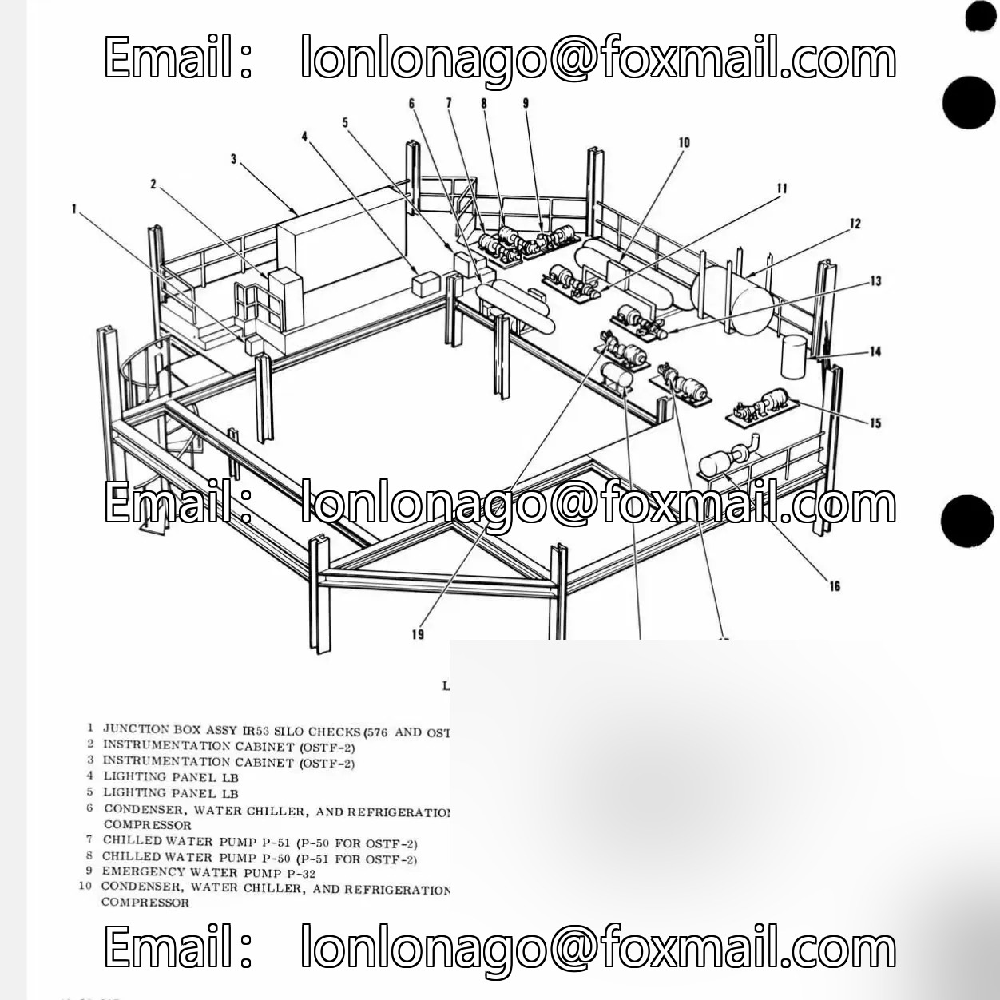
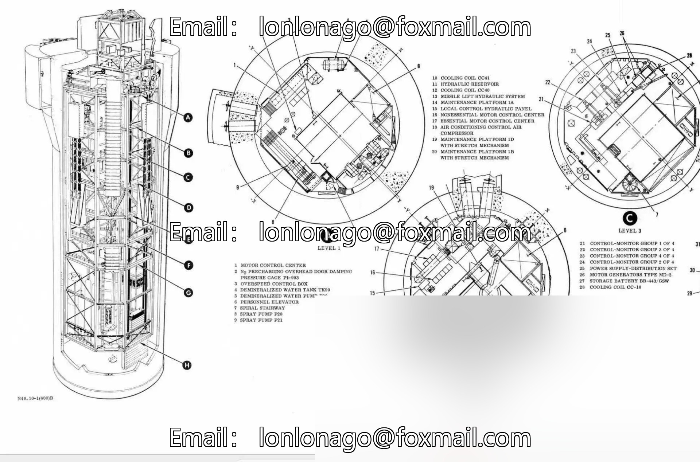
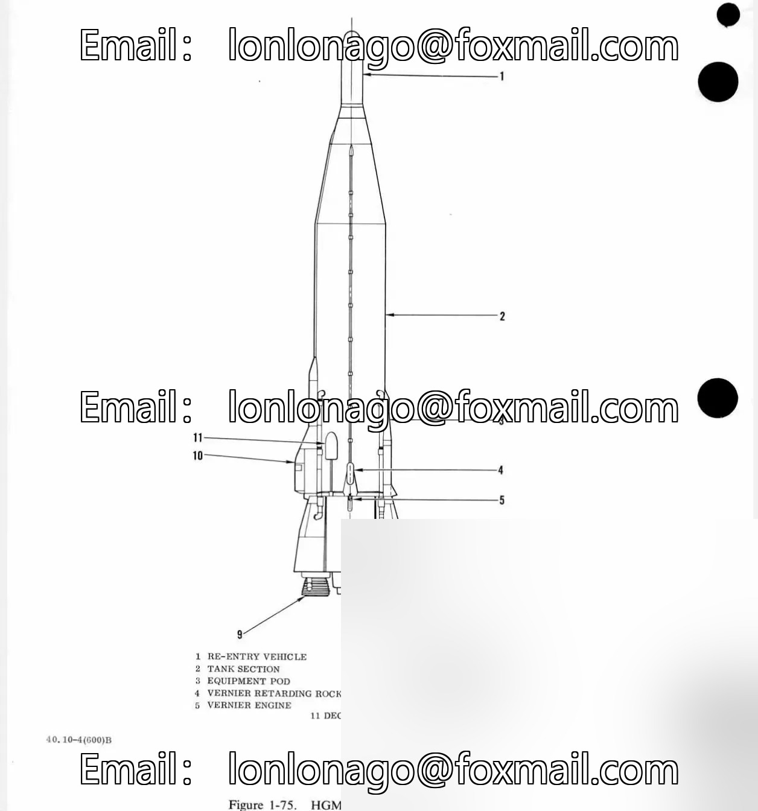
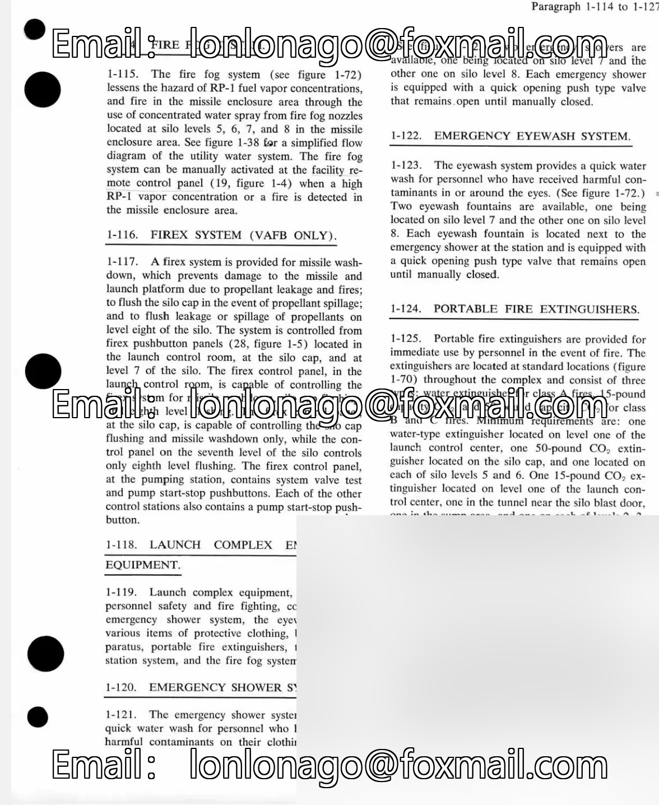

# The Atlas Intercontinental Missile Technical Manual for the Cold War, 1964 edition, lacking

## Body

American Cold War Atlas Intercontinental Missile Technical Operation Manual, 1964 edition, unencrypted version. Approximately 500 pages.
The content covers missile systems, launch bays, equipment layout, operation processes, maintenance and preservation, authoritative and professional, suitable for military enthusiasts, technical reference, and historical research.
Electronic data in PDF format, non-refundable upon sale.

The manual covers missile systems, launch wells, equipment layouts, operation processes and maintenance, along with items such as 40.10-27A and related controls.

<!-- AI_ENRICHED -->

## Images

## Payment

Here is a pay link on Stripe ( https://buy.stripe.com/3cs8yP7sY87d0vu9AB ). Please contact me lonlonago@foxmail.com after funding $89, and I will send you a complete data files , thank you!

